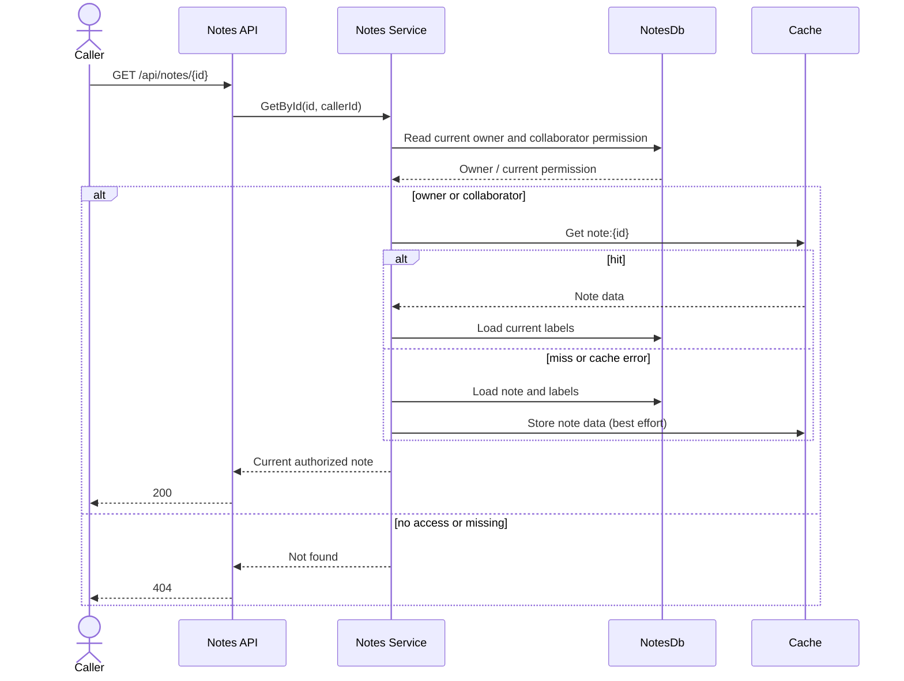
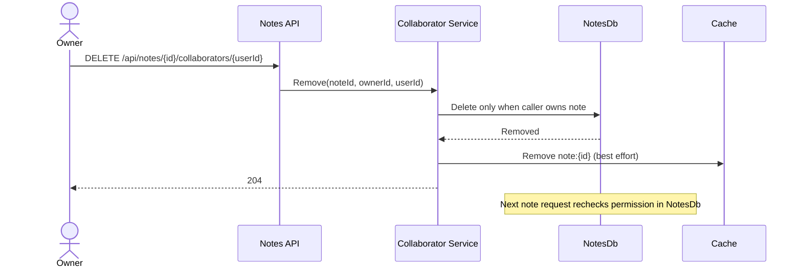
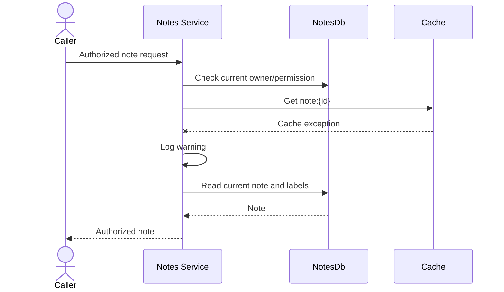

# Note access and collaborators

## Architecture overview

The Notes API authenticates a caller with the existing JWT setup. `NotesController` delegates to `INotesService` and `INoteCollaboratorsService`; the services use note and collaborator repository interfaces. The existing Notes service stores notes in PostgreSQL through parameterized Npgsql repositories. A `NotesDbContext` and EF configurations describe the note and collaborator model and the EF migration adds the collaboration schema. The notes repository remains on the existing Npgsql implementation to avoid changing the established Notes/Labels persistence path in this feature.

Ownership and collaborator permission are read from NotesDb on each note read. The cache contains note data only and uses `note:{noteId:N}` keys with a two-minute TTL. A missing cache entry or cache exception falls back to PostgreSQL. Read authorization is evaluated before cached data is returned. Label associations are reloaded from PostgreSQL even on a note data cache hit, so label edits and replacements are visible immediately.

Collaborator identity is represented by a UUID without a foreign key because UserDb is a separate database. The current project has no Notes-to-User lookup contract; consequently, the add collaborator endpoint cannot verify that an arbitrary non-empty UUID maps to a real UserDb account. A future user-directory contract is needed to meet that validation requirement end to end.

## Request flows

### Get note



### Update note

```mermaid
sequenceDiagram
    actor Caller
    participant API as Notes API
    participant Service as Notes Service
    participant DB as NotesDb
    participant Cache
    Caller->>API: PUT /api/notes/{id}
    API->>Service: Load current note
    Service->>DB: Read owner and current permission
    Service->>DB: Read note using current access
    API->>API: Resource authorization (owner or Edit)
    API->>Service: Save edits
    Service->>DB: UPDATE where row_version matches; increment version
    alt stale version
        DB-->>Service: 0 rows / conflict
        Service-->>Caller: 409 ProblemDetails
    else saved
        Service->>Cache: Remove note:{id} (best effort)
        Service-->>Caller: 200
    end
```

### Remove collaborator



### Cache down



## API endpoint table

| Method | Endpoint | Purpose |
|---|---|---|
| GET | `/api/notes/{id}` | Get an owner or collaborator note; trashed notes are hidden |
| PUT | `/api/notes/{id}` | Update as owner or Edit collaborator |
| PUT | `/api/notes/{id}/archive` | Archive (owner only) |
| PUT | `/api/notes/{id}/unarchive` | Unarchive (owner only) |
| PUT | `/api/notes/{id}/trash` | Move to trash (owner only) |
| PUT | `/api/notes/{id}/restore` | Restore (owner only) |
| DELETE | `/api/notes/{id}` | Permanently delete a trashed note (owner only) |
| GET | `/api/notes/{id}/collaborators` | List collaborators (owner only) |
| POST | `/api/notes/{id}/collaborators` | Add a collaborator with Read or Edit permission |
| PUT | `/api/notes/{id}/collaborators/{userId}` | Change collaborator permission |
| DELETE | `/api/notes/{id}/collaborators/{userId}` | Remove collaborator |
| GET | `/api/notes`, `/archived`, `/trash` | Note lists, paginated with `page` and `pageSize` (max 100) |

## Cache invalidation matrix

| Event | Keys removed |
|---|---|
| Note edit | `note:{noteId}` |
| Archive / unarchive | `note:{noteId}` |
| Trash / restore | `note:{noteId}` |
| Permanent delete | `note:{noteId}` |
| Label attach / detach | `note:{noteId}` |
| Label rename / delete | `note:{noteId}` for every linked note |
| Collaborator add / remove / permission change | `note:{noteId}` |

Invalidation failures are logged and fail open. Permission is always checked in PostgreSQL before a cache hit can be used.

## Design decisions and trade-offs

- The notes repository keeps its current Npgsql SQL style. EF Core configuration and a migration are included for the schema, but switching every existing Notes and Labels query to EF would create a broader storage rewrite and increase regression risk.
- The caller's permission is not cached. A removed collaborator or a Read-to-Edit/Edit-to-Read change takes effect on their next request, even if the note body remains in memory cache.
- Cached note data has a short two-minute TTL. Mutations in this process explicitly invalidate it. Label associations are queried on cache hits to keep label names and membership current.
- `row_version` is a monotonically incremented `bigint` concurrency token. Updates compare the version read with the version in the update predicate and return HTTP 409 when another update wins.
- Note owner and collaborator IDs have no cross-database foreign key. The project currently lacks a user-directory service contract, so real-user validation on share is still an integration gap.
- Existing tests use NUnit and in-memory fakes, so new coverage follows that project convention instead of introducing a second test framework and package set.

## Future improvements

- Add an authenticated internal user-directory API for resolving/validating collaborator IDs.
- Move the cache to Redis through `ICacheService` and use shared invalidation across Notes API instances.
- Adopt EF repositories consistently once the team is ready to migrate the existing SQL persistence layer.
- Add API integration tests with PostgreSQL and `WebApplicationFactory`, including concurrent update and authorization tests.
